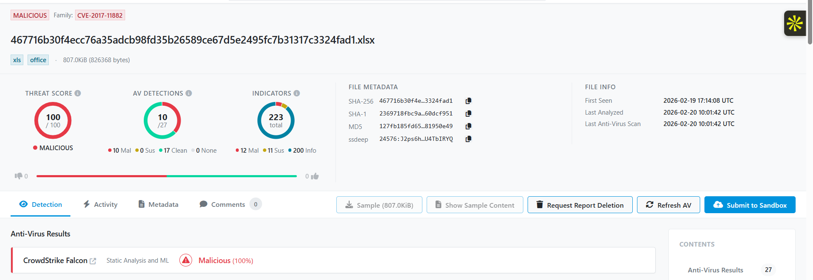

# Malware Behavior Analysis Report

**Sandbox report:** [Hybrid Analysis – Sample 467716b30f4ecc76a35adcb98fd35b26589ce67d5e2495fc7b31317c3324fad1](https://hybrid-analysis.com/sample/467716b30f4ecc76a35adcb98fd35b26589ce67d5e2495fc7b31317c3324fad1)

> **Analysis note:** This report preserves the indicators recorded in the original notes and fills gaps only where the available Hybrid Analysis page or reliable vulnerability context supports doing so. A field marked *Not confirmed in the accessible report* should not be treated as proof that the behavior did not occur. The public page exposed a sample classification and score, but did not expose all behavior tables and screenshots in a form that could be independently verified here.

---

## 1. Sample Information

- **File Name:** `467716b30f4ecc76a35adcb98fd35b26589ce67d5e2495fc7b31317c3324fad1` (original filename not established; this is the SHA-256-based name)
- **File Type:** XLSX (Excel spreadsheet)
- **File Size:** 807.0 KiB (826,368 bytes)
- **MD5 Hash:** `127fb185fd652d378f93f27481950e49`
- **SHA1 Hash:** `2369718fbc9afa01f0939b74a1b3f54e60dcf951`
- **SHA256 Hash:** `467716b30f4ecc76a35adcb98fd35b26589ce67d5e2495fc7b31317c3324fad1`
- **Date of Analysis (recorded in original notes):** 20-02-2026
- **Analyst Name:** Rishab Shorey

---

## 2. Initial Assessment

### 2.1 Detection Summary

- **Hybrid Analysis verdict / score:** Malicious; 100/100
- **Number of AV engines detecting:** 33 / 63 (as recorded in the original analysis notes)
- **Malware Family / Classification:** The sample is associated with `CVE-2017-11882`, `expl` (exploit), and `msexcel` classifications in the original notes. A specific malware family name is not confirmed.
- **Threat Category:** Malicious Office document / exploit (Trojan classification was recorded in the original notes).
- **Relevant vulnerability:** CVE-2017-11882, a stack-based buffer overflow in the Microsoft Office Equation Editor (`EQNEDT32.EXE`) that can allow remote code execution when a crafted document is opened in a vulnerable Office environment.

### 2.2 First Observations

- **Suspicious file name?** The submitted sample is named after its SHA-256 hash. The original filename is not available in the recorded evidence, so a randomly generated original filename cannot be confirmed.
- **Packed or obfuscated?** The original notes mark the sample as packed. Treat this as a sandbox classification; the exact packing or obfuscation method is not identified in the available evidence.
- **Signed or unsigned executable?** Not applicable as a direct executable-signature assessment: the submitted file is an XLSX document, not a PE executable. Signature status of any dropped executable is not established here.
- **Initial assessment:** The malicious verdict, Office document format, and CVE-2017-11882 association indicate a document-based exploitation risk. Opening the document in a vulnerable Office installation could lead to code execution.

---

## 3. Static Analysis

### 3.1 File Metadata

- **Compile Time:** Not applicable / not established for the XLSX document.
- **Creation Time:** Sat Sep 16 00:00:00 2006 (timestamp recorded in the original notes; likely document metadata rather than a reliable malware compilation timestamp).
- **Last Saved Time/Date:** Thu Feb 19 09:13:18 2026 (as recorded in the original notes).
- **PE Sections:** Not applicable to the XLSX container itself. `.XLS.XLS` was recorded in the original notes, but it should not be interpreted as a verified PE section listing.
- **Suspicious Imports:** Not applicable to the spreadsheet container. Imports for any extracted executable payload were not available in the recorded evidence.
- **Suspicious Strings Found:** The original notes refer to suspicious strings in the Hybrid Analysis report, but the exact strings were not transcribed. Review the Strings section of the linked sandbox report before adding individual strings.

### 3.2 Extracted Indicators

**IP Addresses**

- `5.159.62[.]243`
- `185.242.183[.]113`
- `212.132.103[.]22`
- `192.3.101[.]19`
- `107.175.148[.]102`

**Domains / Hostnames / URI indicators**

1. `mpa[.]li/GN3dAE` — shortened URL / URI indicator; final destination not established here.
2. `n9x[.]co`
3. `hxxp://192.3.101[.]19/img/optimized_MSI.png`
4. `hxxp://192.3.101[.]19/img/o`

**URLs**

- The two HTTP URI indicators above are recorded as URLs.
- The shortened URI `mpa[.]li/GN3dAE` should be retained as an indicator, but its redirect destination should not be assumed without resolving it in a safe analysis environment.

**File Paths**

- `%APPDATA%\Microsoft\Office\Recent\467716b30f4ecc76a35adcb98fd35b26589ce67d5e2495fc7b31317c3324fad1.xlsx.xls.LNK`
- `%TEMP%\__PSScriptPolicyTest_t44xlpru[.]weu[.]ps1`
- `%APPDATA%\Microsoft\Office\Recent\index[.]dat`
- `%LOCALAPPDATA%\Microsoft\Windows\INetCache\Content[.]MSO\F609B6D3[.]emf`
- `%TEMP%\__PSScriptPolicyTest_bdxbmkq4.ej4[.]psm1`

---

## 4. Dynamic Behavior Analysis

### 4.1 Process Activity

- **Spawned Processes:** The original notes do not contain the process tree or spawned-process names. The exact parent-child process chain therefore cannot be stated from the available evidence.
- **Injected Processes:** The original notes record a total of **11 process-injection events / injected processes**. The names of the target processes and the injection technique are not available in the transcribed evidence.
- **Analyst note:** Because the sample is associated with CVE-2017-11882, `EQNEDT32.EXE` is relevant to investigate in the process tree. Do not report it, `EXCEL.EXE`, `mshta.exe`, or `powershell.exe` as observed processes unless the sandbox process-activity view confirms them for this sample.

### 4.2 File System Changes

**Files Created**

- **Name:** `sd8f723878ds8f7s7fa82h3kh2k897s7d9as8fd78s7f7s9a89fsf7_1_[.]hta`
- **MD5:** `1610051cc9a5afac3b2741234a658041`
- **SHA1:** `22bc06fff167a55418cc441e945e2cb1daf0940b`
- **SHA256:** `47439b95662b98a38eb5df78060c398db2c7895f91514a339483ffe18f351576`

**Files Modified:** Not confirmed in the accessible evidence.

**Files Deleted:** Not confirmed in the accessible evidence.

### 4.3 Registry Activity

- **Registry Keys Created/Modified:** Registry activity was noted in the original analysis, with a reference to screenshots in the Hybrid Analysis report. However, the actual registry paths, value names, and data were not transcribed and could not be independently verified.
- **Assessment:** Registry modification is an investigation lead, not enough on its own to conclude that a specific Run key, service, or other persistence mechanism was established.
- **Evidence required to complete this field:** Copy the exact registry key path, value name, value data, and operation (created / modified / deleted) from the sandbox's Registry Activity view.

### 4.4 Network Activity

- **Outbound Connections:** The original notes list five IP addresses (Section 3.2). The precise source process, destination port, connection result, and timestamp for each connection are not available in the transcribed evidence.
- **DNS Queries:** `n9x[.]co` is a recorded domain indicator. The DNS query list and query results are not available, so the remaining IPs should not automatically be described as DNS-resolved destinations.
- **C2 Indicators:** The listed IP addresses, domain, shortened URI, and HTTP paths are suspicious network indicators. Their individual roles as command-and-control servers, download hosts, or other infrastructure are not confirmed by the accessible evidence.
- **Protocol Used:** HTTP is indicated by the two `hxxp://` URI entries. Other protocols and destination ports are not established. Do not describe the traffic as using “unused ports” unless the sandbox connection details identify the ports and support that conclusion.

---

## 5. Persistence Mechanisms

The available notes do not provide enough detail to confirm a persistence mechanism.

- **Run Keys:** Not confirmed. Registry activity is mentioned, but no specific Run / RunOnce key is recorded.
- **Scheduled Tasks:** Not confirmed.
- **Services Installed:** Not confirmed.
- **Startup Folder:** A shortcut-like `.LNK` path appears under the Office Recent directory, but this does not establish Startup-folder persistence.
- **Assessment:** Persistence remains undetermined from the evidence transcribed into this report. Confirm it using the sandbox's registry, task, service, and file-system behavior sections.

---

## 6. MITRE ATT&CK Mapping

The following is a cautious mapping based on the sample's recorded classification and evidence. It is not a claim that every technique was conclusively observed.

| Technique | ID | Relevance / evidence |
|---|---|---|
| Exploitation for Client Execution | T1203 | Relevant to the CVE-2017-11882 Office document exploit association. Confirm the exact execution chain in the sandbox. |
| User Execution: Malicious File | T1204.002 | Relevant if user interaction (opening the spreadsheet) is required; the precise execution trigger is not documented in the transcribed evidence. |
| Process Injection | T1055 | The original notes record 11 injection events. The exact injection sub-technique is unknown. |
| Command and Scripting Interpreter: PowerShell | T1059.001 | PowerShell-related `.ps1` and `.psm1` paths are recorded. Confirm actual PowerShell execution in process telemetry before treating this as observed execution. |
| Ingress Tool Transfer | T1105 | Possible only if the network activity confirms payload retrieval; not established by the listed indicators alone. |

---

## 7. Indicators of Compromise (IOCs)

### File Hashes

| File | MD5 | SHA1 | SHA256 |
|---|---|---|---|
| Submitted XLSX sample | `127fb185fd652d378f93f27481950e49` | `2369718fbc9afa01f0939b74a1b3f54e60dcf951` | `467716b30f4ecc76a35adcb98fd35b26589ce67d5e2495fc7b31317c3324fad1` |
| Created HTA file | `1610051cc9a5afac3b2741234a658041` | `22bc06fff167a55418cc441e945e2cb1daf0940b` | `47439b95662b98a38eb5df78060c398db2c7895f91514a339483ffe18f351576` |

### Network Indicators

**IP addresses**
- `5.159.62[.]243`
- `185.242.183[.]113`
- `212.132.103[.]22`
- `192.3.101[.]19`
- `107.175.148[.]102`

**Domains / hostnames**
- `n9x[.]co`
- `mpa[.]li` (shortened-link host; path `/GN3dAE`)

**URLs**
- `hxxp://192.3.101[.]19/img/optimized_MSI.png`
- `hxxp://192.3.101[.]19/img/o`
- `hxxp://mpa[.]li/GN3dAE`

### Host Indicators

**File paths**
- `%APPDATA%\Microsoft\Office\Recent\467716b30f4ecc76a35adcb98fd35b26589ce67d5e2495fc7b31317c3324fad1.xlsx.xls.LNK`
- `%TEMP%\__PSScriptPolicyTest_t44xlpru[.]weu[.]ps1`
- `%APPDATA%\Microsoft\Office\Recent\index[.]dat`
- `%LOCALAPPDATA%\Microsoft\Windows\INetCache\Content[.]MSO\F609B6D3[.]emf`
- `%TEMP%\__PSScriptPolicyTest_bdxbmkq4.ej4[.]psm1`
- `sd8f723878ds8f7s7fa82h3kh2k897s7d9as8fd78s7f7s9a89fsf7_1_[.]hta`

**Registry Keys**
- Specific key paths and values were not available in the transcribed evidence. Retrieve them from the Hybrid Analysis Registry Activity view before deploying registry-based IOC detections.

---

## 8. Risk Assessment

- **Impact Level:** High. The sample is classified as malicious with a 100/100 Hybrid Analysis score and is associated with an Office remote-code-execution vulnerability. This is a qualitative assessment, not a measured impact on an actual victim.
- **Target Type:** Windows endpoints running vulnerable Microsoft Office / Equation Editor components.
- **Data Theft Capability:** Not confirmed by the evidence recorded in this report. Do not mark “Yes” without a sandbox behavior, payload, or network finding that demonstrates collection or exfiltration.
- **Lateral Movement Risk:** Not confirmed. No lateral movement behavior is documented in the available evidence.
- **Execution Risk:** High for systems with vulnerable Office components if the document successfully triggers the exploit.

---

## 9. Recommended Mitigation

1. **Block and monitor network indicators:** Add the listed IPs, domains, and URLs to appropriate threat-intelligence and network-security controls after validating relevance and checking for shared hosting or false positives.
2. **Quarantine the sample:** Prevent the XLSX file and the identified HTA file from being opened or executed. Search endpoints and mailboxes for the sample hash and filename.
3. **Isolate suspected infected endpoints:** If execution is confirmed, isolate affected hosts in accordance with incident-response procedures while preserving evidence.
4. **Patch Microsoft Office:** Ensure supported Office versions and security updates are installed. Specifically address CVE-2017-11882 and remove or disable vulnerable legacy Equation Editor components where applicable.
5. **Investigate execution and persistence:** Review Office / Equation Editor process activity, PowerShell execution, process-injection telemetry, registry changes, scheduled tasks, services, and Startup locations.
6. **Hunt for related artifacts:** Search for the listed file paths, hashes, and network indicators across endpoint, proxy, DNS, firewall, and EDR telemetry.
7. **Credential response:** Reset credentials and revoke active sessions only if there is evidence or reasonable incident-response grounds to suspect credential exposure. Review privileged and user-account activity.
8. **Strengthen endpoint monitoring:** Monitor suspicious Office child processes, script interpreters, HTA execution, unusual process injection, and unexpected outbound connections.

---

## 10. Final Verdict

The submitted XLSX sample is classified as **malicious** by Hybrid Analysis, with a reported score of **100/100**. The original analysis notes associate it with `CVE-2017-11882`, a Microsoft Office Equation Editor vulnerability that can allow code execution when a specially crafted document is opened on a vulnerable system.

The recorded sandbox indicators include five IP addresses, the domain `n9x[.]co`, HTTP URI paths hosted at `192.3.101[.]19`, multiple temporary PowerShell-related files, an Office Recent-folder shortcut-like artifact, and a created HTA file. The original notes also record 11 process-injection events and registry activity. These behaviors and artifacts warrant treating the sample as a high-risk malicious Office document.

The exact process tree, registry paths and values, persistence method, network ports, C2 role of each destination, data-exfiltration behavior, and lateral-movement activity are **not established by the evidence transcribed into this report**. Those details should remain unconfirmed until the corresponding Hybrid Analysis behavior views are reviewed. The sample should not be executed on a production endpoint.

---

## References

- [Hybrid Analysis – Original sample report](https://hybrid-analysis.com/sample/467716b30f4ecc76a35adcb98fd35b26589ce67d5e2495fc7b31317c3324fad1)
- [Google Cloud / Mandiant – CVE-2017-11882 exploitation background](https://cloud.google.com/blog/topics/threat-intelligence/targeted-attack-in-middle-east-by-apt34/)
- [Palo Alto Networks Unit 42 – Analysis of CVE-2017-11882 exploit activity](https://unit42.paloaltonetworks.com/unit42-analysis-of-cve-2017-11882-exploit-in-the-wild/)
