# Vulnerability Management 


**Aim:** The basic foundation of vulnerablity management, its use as in Cybersecurity teams, and how do Red Teams, and Blue teams intent to use various Vulnerability Management tools and their use case comparing which is an ideal approach to find vulnerabilities.

**Defining Vulnerability**

As per NIST - A weakness in an information system, system security procedures, internal controls, or implementation that could be exploited or triggered by a threat source"

It is a process of identifying, detecting, mitigating, and reporting a vulnerability in a system in line with standard frameworks.

## Understanding of Vulnerability Scanning vs Vulnerability Management

**Vulnerability Management**

Vulnerability management is an ongoing, proactive, and frequently automated activity that protects computer systems, networks, and enterprise solutions from cyberattacks and data breaches. 

By discovering, evaluating, and correcting potential security flaws, businesses can help avoid attacks and mitigate their effects if they occur.

**Vulnerability Scanning**

Since vulnerability management is the process surrounding vulnerability scanning, it is essential to know how vulnerability scans are conducted and the tools at hand. Today, operating a vulnerability scanning tool requires little technical knowledge. 

Most vulnerability scanners may be operated via a graphical user interface, allowing a user to do vulnerability scans on a whole network with a few mouse clicks.

Some popular commercial vulnerability scanning tools which we will use is include Nessus, OpenVas, Nexpose, and Acunetix. 


The Difference between these two: 

> **Vulnerability Scanning:** Utilising a computer program to find vulnerabilities in networks, computer infrastructure, or applications constitutes vulnerability scanning. 


> **Vulnerability management:** is the process that encompasses **vulnerability scanning**, as well as other factors, including but not limited to risk acceptance, remediation, and reporting.  Vulnerability management should be a continual effort to stay up with new and emerging threats.


**Simple Example:** Think of a vulnerability scan as a medical checkup report that lists your health issues, while vulnerability management is your entire healthcare and fitness plan to get healthy and stay that way.

**Brief Example:**

On Monday night, an automated scanner runs across the network. It flags Server 42 because it is running an outdated version of Apache web server software. The scanner generates a report showing a "Critical Vulnerability (CVE-2026-XXXX)" that could allow remote code execution.

Now as we know the vulnerability in the system, it is a potential exploit spot.

The vulnerability management lifecycle now takes over that raw data to actually solve the problem:

- **Prioritisation**: The security team evaluates the alert. If Server #42 holds public customer data, it is prioritised immediately. If it is an isolated testing server with no data, it is given a lower priority

- **Remediation (Patching)**: The security team opens a ticket for the IT systems team. The IT team tests the necessary software update in a staging environment to ensure it doesn't crash the website, then applies the patch to Server #42.
- **Verification**: The security team runs another scan specifically on Server #42 to confirm the vulnerability is completely gone.
- **Reporting:** The security manager updates the company's risk dashboard to show the leadership team that the critical flaw was resolved within their 48-hour SLA target.

## The Red Team or Blue Team

Now the question is since finding vulnerabilities is done by Red Team, to exploit them to find crucial bugs within the system, but Vulnerability management and vulnerability scanning are **primarily used by the blue team** to proactively discover, track, and patch security weaknesses

## Tools Used for Vulnerability Scanning and Management

We are going to target multiple tools to see to gain an understanding and how things works.

### OpenVAS

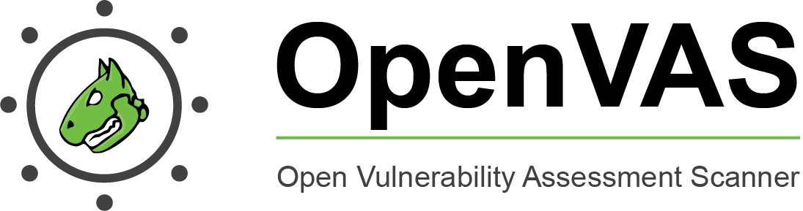

OpenVAS, an application used to scan endpoints and web applications to identify and detect vulnerabilities. It is commonly used by corporations as part of their mitigation solutions to quickly identify any gaps in their production or even development servers or applications. 

This is not an end all be all solution but can help to get rid of any common vulnerabilities that may have slipped through the cracks.  

#### Greenbone Framework Architecture

As previously mentioned OpenVAS is built off the **GreenBone Vulnerability Management (GVM) solution** and is only one of the appliances that is released from GreenBone. 

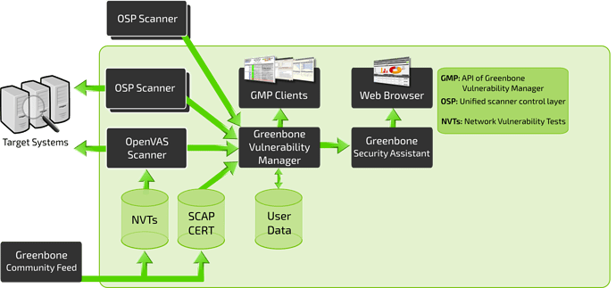


It is divided into three sections: Front-End, Back-End, and Vulnerability/Information feed

- **Vulnerability/Information Feed (NVT, SCAP CERT, User Data, Community Feed)** This section will contain *all information and vulnerability tests* that come from the Greenbone Community Feed that will be the main baseline for testing against systems.  This can also include User Data provided by the user in the NVT

- **Back-End (OSP, OpenVAS, Targets)** The back-end infrastructure is what will be actually conducting all of the vulnerability scanning and processing data and NVTS through OpenVAS and GVM

- **Front-End (GSA, Web Interfaces)** This is what you interact with when you navigate to OpenVAS in your browser. The web interfaces are built off of the Greenbone Security Assistant and make life easier for an analyst or operator when working with OpenVAS

#### Installing OpenVAS

**There are 3 options to install:**

- Installing from repositories can sometimes be very simple or it can be a very painful process. For OpenVAS, the installation ranges in difficulty and can require many configurations ran


> https://websiteforstudents.com/how-to-install-and-configure-openvas-on-ubuntu-18-04-16-04/


- Installing from source is the least preferred option for beginners and the least optimized way of installing OpenVAS due to prerequisites and make errors.

- Docker is by far the easiest of all three installation methods and only requires one command to be run to get the client started. For this installation procedure, you will need docker installed. 

``` bash
1. sudo apt install docker
2.  docker run -d -p 443:443 --name openvas mikesplain/openvas
```

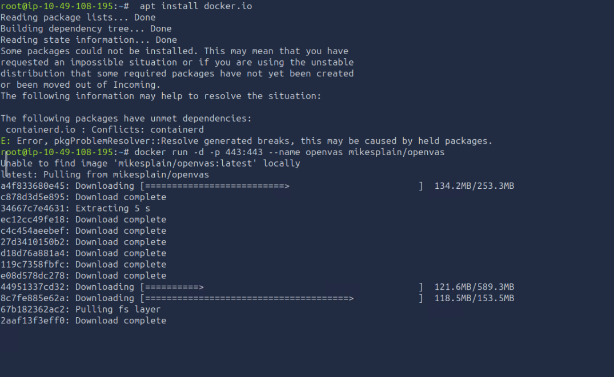

When installed always ensure to test it once to see if things are working: 

- Begin by navigating to Scans > Tasks and clicking on the **purple magic wand icon** to begin the basic configuration wizard. We recommend beginning a scan on 127.0.0.1 to test out your installation and ensure it is working properly.

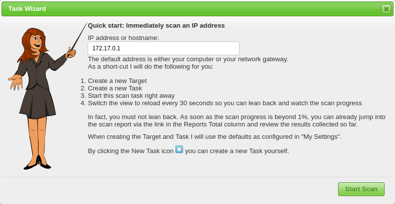

- If you successfully navigated to the wizard you should see a pop-up similar to the one above. This is where you will set up your initial scan against your localhost to ensure everything is properly configured.

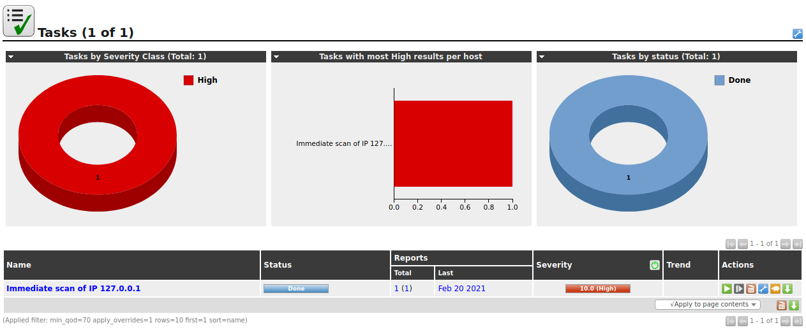

This is what it will look like

#### Scanning and Setting up a Task

We first create a task for this lab: 

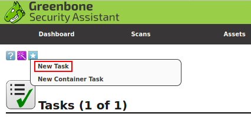

Now after clicking it we have a large number of options in front of us as displayed:

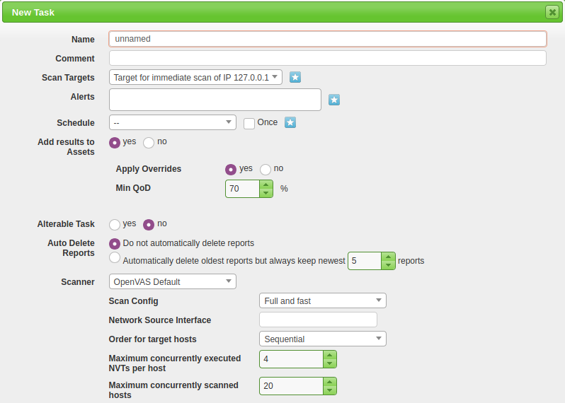

Only details we will be filling is the: Name, Scan Targets, and Scanner Type, and Scan Config.


- **Name:** Allows us to set the name the scan will be known as inside of OpenVAS
- **Scan Targets:** The targets to scan, can include Hosts, Ports, and Credentials. To create a new target you will need to follow another pop-up, this will be covered later in this task.
- **Scanner:** The scanner to use by default will use the OpenVAS architecture however you can set this to any scanner of your choosing in the settings menu.
- **Scan Config:** OpenVAS has seven different scan types you can select from and will be used based on how you aggressive or what information you want to collect from your scan.

Lets now go and scope a target for which we want to scan, we have to ensure to click the star icon as seen above for the target scan:

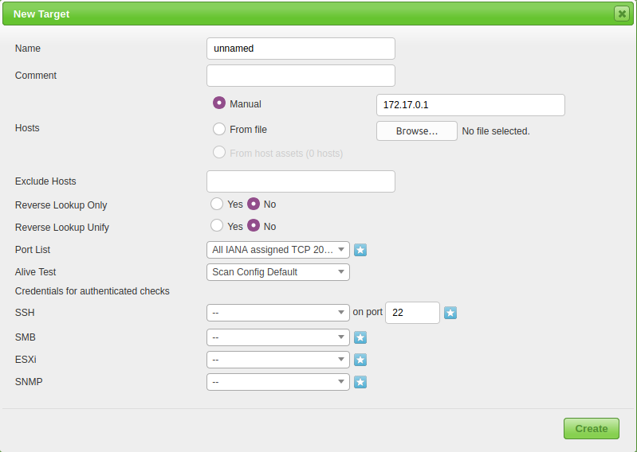

> Do note, that you do not use this IP Address as this is a simulated enviornment and it is just used for practice scenario.

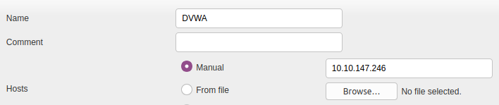

Above is the menu for configuring a new target. The two main options you will need to configure are the Name and the Hosts. 

Once you create the task you will be brought back to the scan dashboard where you can monitor and start your task. To start the task navigate to the start icon under Actions.


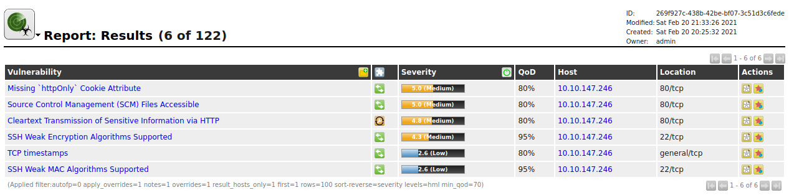

#### Reporting and Monitoring

**OpenVAS** has very strong reporting and monitoring capabilities that can contribute to an efficient and optimal solution in your build or vulnerability management pipeline.

- Since we have a report in hand, it starts with some basic host and task information including Host, Start, End, and Vulnerability categories. 

- Then it follows up with Vulnerabities finding. We can gather a summary of the vulnerability, detection details, mitigation details, and method of detection.

- We can also create configurable schedules, configure the type of alerts

### Open VAS - Practical Vulnerability Management

**Question:** When did the scan start in Case 001?

**Answer:** Feb 28, 00:04:46

**Question:** When did the scan end in Case 001?

**Answer:** Feb 28, 00:21:02

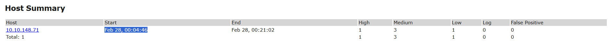


**Question:** How many ports are open in Case 001?

**Answer:** 3

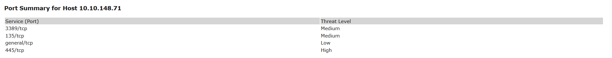


**Question:** What is the highest severity Vulnerability Found?

**Answer:** MS17-010.

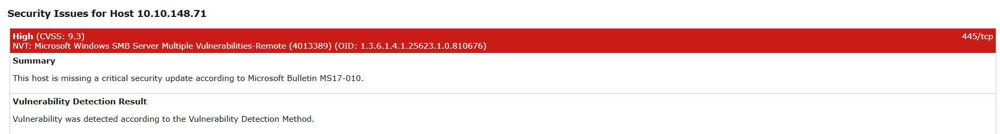


**Question:** What is the first affected OS to this vulnerability?

**Answer:** Microsoft Windows 10 x32/x64 Edition

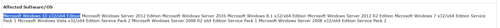

**Question:** What is the recommended vulnerability detection method?

**Answer:** Send the crafted SMB transaction request with fid = 0 and check the response to confirm the vulnerability.

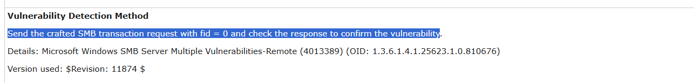

