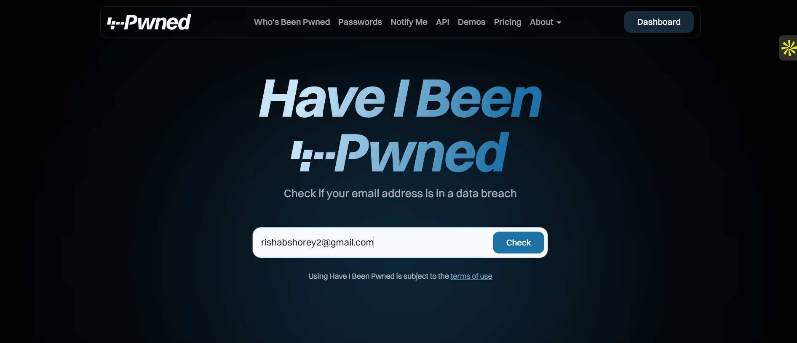
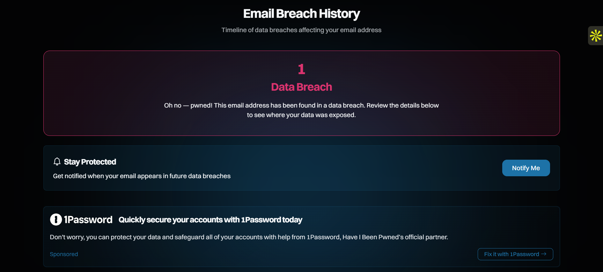
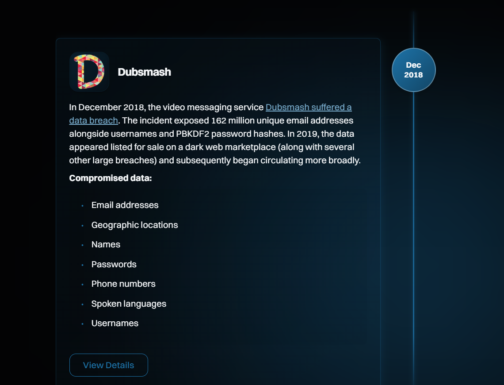

# Analyzing Threat Vectors and Public OSINT Tools via the Dubsmash Data Breach

## 1. Overview & Objective

Investigating the mechanics of a massive database exfiltration, tracking third-party operational risk management, and leveraging Open-Source Intelligence (OSINT) platforms to discover credential exposure.

---

## 2. Threat Intelligence & OSINT Tools: What is "Have I Been Pwned"?

A critical first step in security analysis is recognizing whether corporate or individual data assets have already been compromised. 

## Definition & Architecture

- **[Have I Been Pwned (HIBP)](https://haveibeenpwned.com/ "Have I Been Pwned")** is a trusted public OSINT repository created and managed by security expert Troy Hunt. 
- It indexes multi-billion record datasets of leaked databases, text files, and credential dumps that surface on underground hacker forums and dark web marketspaces.

- **How it operates:** The platform aggregates compromised records (emails, user IDs, and past credentials). Individuals and enterprise administrators can pass cleartext queries of their domains to quickly cross-reference identity parameters against historical data leaks without putting their active systems at risk.

### Security+ Tool Alignment

- **Passive Reconnaissance:** HIBP allows security analysts to perform domain exposure assessments without directly executing disruptive scanning vectors on internal infrastructures or touching threat actor networks.
- **Credential Stuffing Mitigation:** Many Identity and Access Management (IAM) systems ingest HIBP data feeds programmatically to reject known breached strings during user sign-ups or corporate password modification cycles.

---

## 3. Case Study Analysis: The 2018 Dubsmash Breach

### What Took Place in the Breach

In **December 2018**, the backend infrastructure of the short-form video application Dubsmash was targeted by a malicious threat actor. 

- **The Bulk Exfiltration:** The intruder successfully bypassed system segmentation layers and exfiltrated a massive primary database containing **161.7 million unique user accounts**. 

- **Data Types Exposed:** The stolen dataset was extensive, exposing user email addresses, account creation timestamps, profile names, phone numbers, localized country data, spoken language codes, and cryptographic password strings.

- **The Underground Monetization:** The incident went publicly unannounced until **February 2019**, when a prominent cybercriminal actor (attributed as part of a multi-platform distribution dump) put the entire 161 million record package up for sale on the **Dream Market** dark web marketplace. The data was sold individually and bundled into a massive multi-company compromise set, making it highly accessible to buyers across global underground crime syndicates.

### How the Breach Happened (Technical & Vulnerability Context)

While the exact zero-day entry exploit or definitive single vulnerability remains obscured due to limited post-incident public forensic documentation from the vendor, the systemic structural failures behind how this database compromise was accomplished fall into clear architectural categories:

1. **Inadequate Database Perimeter Defense:** The attacker successfully executed an unauthorized backend database connection. This points heavily to an application-level vulnerability (such as a classic input validation bypass like SQL Injection) or an improperly protected database endpoint exposed to the public Internet.

2. **Horizontal Privilege Escalation:** Once the threat actor made initial contact with the network environment, weak access controls permitted lateral traversal from an unauthenticated user portal down into the primary operational datastores.

3. **Absence of Real-Time Data Exfiltration Alerts:** The attacker transferred hundreds of gigabytes of unstructured data out of the internal ecosystem undetected. This signifies a lack of active network behavioral monitoring, egress traffic filtering, or data loss prevention (DLP) parameters to intercept unusual bulk querying.

---

## 4. CompTIA Security+ Core Domain Mapping

### Domain 1: Threats, Attacks, and Vulnerabilities

- **Credential Stuffing (Tactic):** Malicious actors take the millions of cleartext emails and matching password hashes, attempt automated dictionary cracking routines, and push the cracked pairs into automated script bots targeting high-value corporate VPN endpoints, cloud management instances, or remote email services.

- **Offline Brute-Force Attacks:** Since the raw database file was directly exfiltrated, attackers possess an infinite timeline to subject the password strings to high-performance GPU arrays without running the risk of account lockouts or detection by firewall alerts.

### Domain 2: Architecture and Design

- **Cryptographic Salting and Key-Stretching:** Dubsmash utilized **PBKDF2** (Password-Based Key Derivation Function 2) to protect user passwords. PBKDF2 applies an internal salt alongside hundreds of mathematical iterations, substantially slowing down the rate at which simple brute-force applications can decipher the original password text. This layer of protection saved millions of complex profiles from immediate, automated compromise.

- **The Risk of Bulk Cloud Datastores:** Massive centralized user repositories serve as high-reward "honeypots" for malicious actors. Security+ objectives emphasize structural database tokenization and object-level access validation to render exfiltrated files unusable.

### Domain 3: Security Operations & Incident Response

- **Open-Source Intelligence (OSINT) Checks:** Integrating automated credential scanning via services like the [Have I Been Pwned API](https://haveibeenpwned.com "HIBP API Documentation") lets operations teams detect compromised active organizational email addresses immediately after a dark-web drop occurs.

- **Zero-Trust Network Design:** Implementing strict perimeter identity policies ensures that even if a public application server is breached, the attacker remains isolated from accessing deeper database tables.

---

## 5. Lab Assessment Questions

1. **Why does a database compromise on an external consumer app like Dubsmash pose an immediate threat to a separate, high-security enterprise network?**
   * *Answer:* Users consistently reuse identical email and password credentials across personal accounts and corporate enterprise workstations. This allows bad actors to turn low-value third-party app leaks into highly effective enterprise credential-stuffing points.

2. **How does the implementation of an algorithm like PBKDF2 alter the attacker's workflow following a massive database exfiltration?**
   * *Answer:* Unlike fast algorithms (like MD5), PBKDF2 uses computationally expensive key-stretching iterations. This slows down offline mass brute-force processing on hardware clusters, making dictionary-cracking attempts on complex passwords highly impractical and time-consuming.

3. **What form of security detection parameter was visibly absent during the timeline of the Dubsmash exfiltration?**
   * *Answer:* The absence of Data Loss Prevention (DLP) frameworks or network egress monitoring allowed threat actors to transfer millions of comprehensive user records entirely undetected without triggering anomaly thresholds or network isolation protocols.
