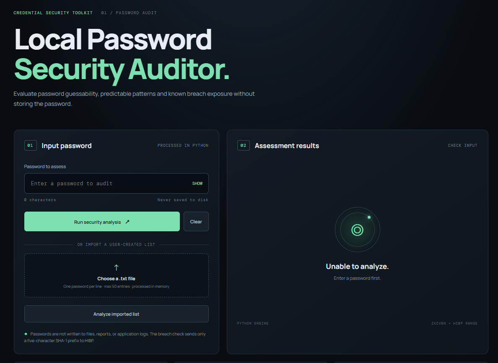

# Local Password Security Auditor

A localhost-only password assessment tool. The browser provides the interface; all password analysis runs in Python.




## Features

- Manual password assessment and user-created newline-delimited `.txt` list import.
- Length and character-class analysis.
- Repeated-character and predictable-sequence checks.
- `zxcvbn` guessability scoring, estimated guesses, and an illustrative crack-time category.
- Local common-password blocklist.
- Optional Have I Been Pwned (HIBP) Pwned Passwords range lookup using k-anonymity: only the first five SHA-1 hexadecimal characters are sent; matching suffixes are compared locally.
- Recommendations and a privacy-focused UI.

## Run locally

Python 3.10+ is recommended.

```bash
python -m venv .venv

# Windows PowerShell
.venv\Scripts\Activate.ps1

pip install -r requirements.txt
python app.py
```

Open <http://127.0.0.1:5050>.

> The server binds to `127.0.0.1` only. Do not change this to `0.0.0.0` or expose it to a network without a separate security review.

## Input file format

Create a UTF-8 `.txt` file with one password per line. The app accepts up to 50 non-empty lines and 256 KB. The file is read in memory by the request handler and is not saved by the application.

## Privacy and data handling

- Passwords are held in process memory while the request is analyzed.
- The application does not write passwords or hashes to a database, file, report, or application log.
- The browser sends the password to the local Python Flask service.
- For HIBP checks, Python computes SHA-1 locally and sends only the first five hexadecimal characters to `https://api.pwnedpasswords.com/range/`. Returned suffixes are compared locally. The full hash and original password are not sent.
- HIBP checks require internet access. If unavailable, the result is marked `unavailable`.
- Clear the input after use and close the local app when finished. Python cannot guarantee immediate physical erasure of immutable string objects from process memory.

## Important interpretation notes

- zxcvbn score ranges from 0 to 4 and estimates guessability; it is not a guarantee.
- Crack-time categories use zxcvbn's `offline_slow_hashing_1e4_per_second` scenario and are illustrative only. Real attack speed depends on hashing algorithm, hardware, and attacker resources.
- The local common-password list is a small starter list, not a comprehensive dictionary.
- A password not found in HIBP is not necessarily safe or unique.
- The tool is an educational local audit aid, not a substitute for a password manager, MFA, breached-credential controls, or an organization's approved password policy.

## Project structure

```text
local_password_security_auditor/
├── app.py
├── requirements.txt
├── README.md
├── templates/
│   └── index.html
└── static/
    ├── app.js
    └── style.css
```

## API

- `POST /api/analyze` — JSON body: `{"password":"...","check_breach":true}`
- `POST /api/analyze-list` — multipart upload field `file`, one password per line

The API returns assessment metadata only. It never returns the password or its hash.
